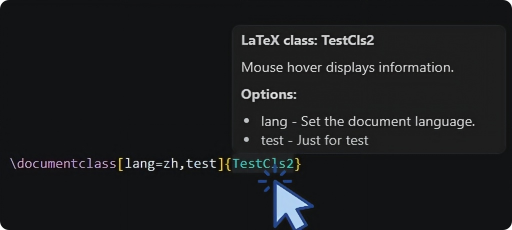
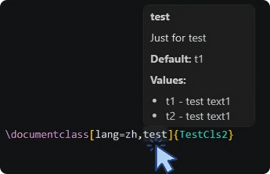

# TeX Hover Docs

[English](README.md) | [简体中文](README.zh-CN.md)

TeX Hover Docs 可在 VS Code 中直接显示自定义 LaTeX 文档类和 Beamer 主题的说明。说明内容保存在对应的 `.cls` 或 `.sty` 文件中，便于与定义一起维护。

> <span style="color: red; font-weight: bold;">⚠️ 本项目重度依赖AI制作，虽然本人使用尚未发现问题，但请自行评估风险。</span>

## 功能

- 悬停文档类或主题名称，查看整体说明和已记录的选项。
- 悬停选项名，查看描述、默认值和已记录的可选值。
- 悬停已记录的选项值，查看该值的含义。
- 查找当前工作区中的定义文件；工作区内找不到时，可通过 `kpsewhich` 查找 TeX 发行版中的文件。
- 如果定义文件已在 VS Code 中打开，未保存的修改也会用于悬停提示。

例如，工作区或 TeX 搜索路径中存在 `MyClass.cls` 时，下面的命令可以显示类和 `lang` 选项的说明：

```latex
\documentclass[lang=en]{MyClass}
```

## 效果预览





## 为文档类添加说明

在 `MyClass.cls` 中放置一个元数据块。标记行和 JSON 内容的每一行都必须是 LaTeX 注释。`name` 必须与 `\documentclass` 中使用的类名一致。

```latex
% vscode-hover:begin
% {
%   "kind": "class",
%   "name": "MyClass",
%   "description": "支持中英文的学位论文模板。",
%   "options": {
%     "lang": {
%       "description": "设置文档语言。",
%       "default": "zh",
%       "values": {
%         "zh": "简体中文。",
%         "en": "英文。"
%       }
%     },
%     "linenum": {
%       "description": "控制行号显示。",
%       "default": "none",
%       "values": {
%         "none": "不显示行号。",
%         "text": "仅为正文显示行号。",
%         "all": "为所有内容显示行号。"
%       }
%     }
%   }
% }
% vscode-hover:end
```

每个选项都需要 `description`。`default` 和 `values` 是可选字段。`values` 中的每个键值对表示“选项值：说明”。元数据允许在对象或数组末尾使用逗号。

## 为 Beamer 主题添加说明

对于 `\usetheme{MyTheme}`，将元数据写入 `beamerthemeMyTheme.sty`，并将 `kind` 设为 `theme`。

```latex
% vscode-hover:begin
% {
%   "kind": "theme",
%   "name": "MyTheme",
%   "description": "适用于学术报告的演示文稿主题。",
%   "options": {
%     "lang": {
%       "description": "设置主题标签的语言。",
%       "default": "zh",
%       "values": {
%         "zh": "中文标签。",
%         "en": "英文标签。"
%       }
%     }
%   }
% }
% vscode-hover:end
```

## 定义文件查找

扩展会优先搜索当前工作区：

- `\documentclass{MyClass}` 对应 `MyClass.cls`。
- `\usetheme{MyTheme}` 对应 `beamerthemeMyTheme.sty`。

如果工作区中没有对应文件，扩展会使用 `kpsewhich` 查询该文件。所有定义文件都在工作区时不需要安装或配置 `kpsewhich`。如果定义文件安装在 TeX Live 或其他 TeX 发行版中，请确保 VS Code 进程的 `PATH` 中能找到 `kpsewhich`。

### 扩展设置

`texHoverDocs.kpsewhichPath` 用于指定查找 TeX 文件时调用的可执行文件，默认值为 `kpsewhich`。如果它不在 `PATH` 中，可在 VS Code 的 `settings.json` 中指定完整路径，例如：

```json
{
  "texHoverDocs.kpsewhichPath": "D:\\Application\\LaTeX\\texlive\\2025\\bin\\windows\\kpsewhich.exe"
}
```

## 环境要求

- Visual Studio Code 1.146.0 或更高版本。
- 只有在定义文件位于工作区之外时才需要 `kpsewhich`。

## 构建与测试

```sh
npm install
npm test
npx @vscode/vsce package
```

如需从源码运行扩展，请在 VS Code 中打开本目录并按 `F5`，启动扩展开发宿主。生成的 `.vsix` 可通过以下命令安装：

```sh
code --install-extension tex-hover-docs-0.1.0.vsix
```

## 支持范围与限制

扩展只提供文档提示，不会校验选项，也不会改变 LaTeX 对选项的处理方式。当前识别直接写出的 `\documentclass[...]{...}` 和 `\usetheme[...]{...}` 命令，支持多行参数并忽略注释中的示例。扩展不会展开宏，也无法解析由其他命令动态生成的类名或主题名。同名定义同时存在时，工作区文件优先于 TeX 发行版中的文件。

## 许可证

[MIT](LICENSE)
